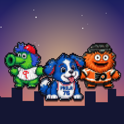
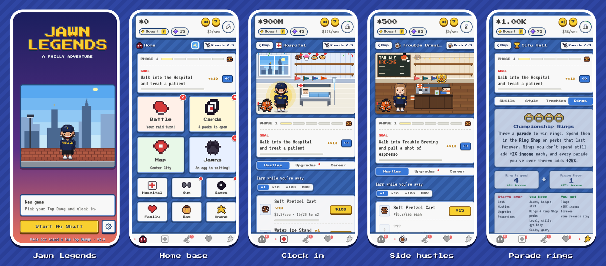
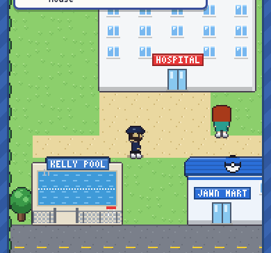
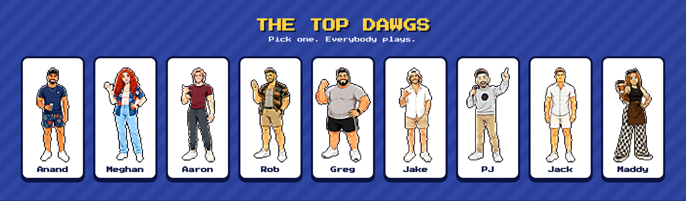
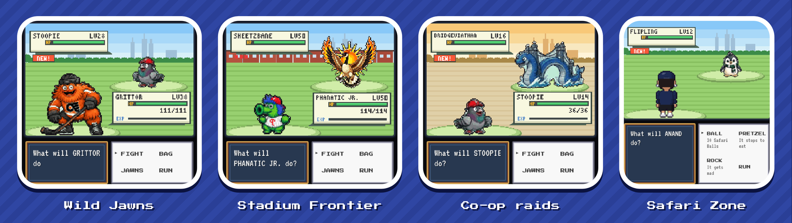
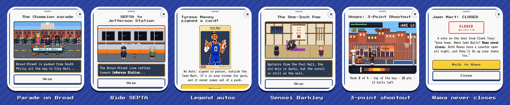
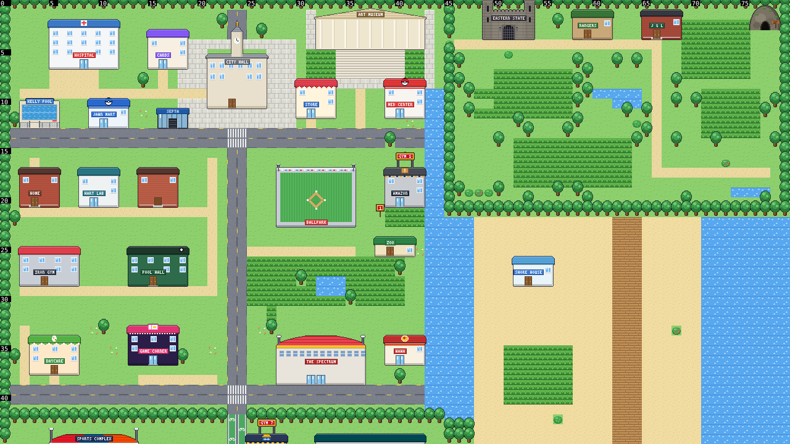
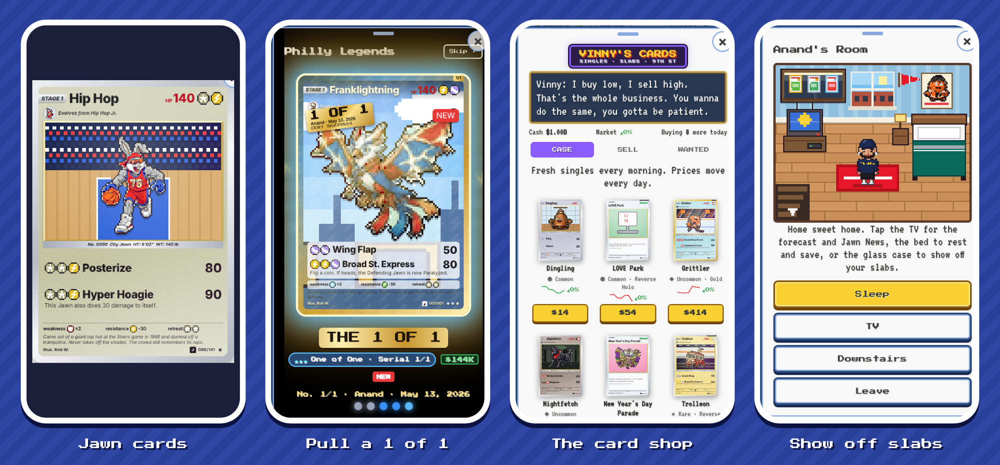
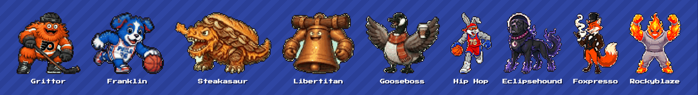

  

<h1 align="center">Jawn Legends</h1>

<b>Gotta catch every jawn.</b> 
A Philly pocket-monster adventure and idle game for iPhone, in full GBA-era pixel art.

  

---

## The pitch

Jawn Legends started as a gift for one friend and turned into a full game. It plays like the handheld monster-catchers you grew up on, set in a pixel-perfect Philadelphia: walk the city, catch Jawns in the tall grass of Fairmount Park, take on eight gyms run by your friends, then come back hours later to find your side hustles kept earning while you were away.

It's two games in one:

- **The adventure.** A FireRed-style overworld with turn-based battles, gyms, rivals, an Elite Four on Broad Street, legendary hunts and a story told one tap at a time.
- **The idle game.** Clock in at your job, stack side hustles from a soft pretzel cart to a sports empire, throw championship parades and spend the rings on perks that last forever.

  

## The Top Dawgs

  

The Top Dawgs are a real crew of friends, drawn as pixel art. Pick any one of them to play as: each has their own job on the Work screen and their own scenes, and the rest show up around the city as gym leaders, rivals and the people cheering you on at the parade. Their mascot is **Barkley**, a real gray-muzzled old dog who roams the map as a legendary, runs from battle and turns out to be a kung-fu sensei.

## Battle Philly

  

- **117 Jawns** across 15 types, with evolutions, natures, abilities, shinies and 149 moves, all drawn as hand-tuned pixel sprites.
- **Gen 3-style battles**: animated attacks, status effects, a battle transition you'll recognize, and a follower Jawn that walks behind you.
- **Eight gyms plus bonus gyms**, each led by a friend, then the Broad Street Four and a Champion.
- **Stadium Frontier** cups, **co-op raids** you take turns on with friends, a **Safari Zone** at the zoo, and trainers who spot you from across the street.
- **Legends of Philly**: legendary Jawns hinted at around town, plus Barkley roaming the map.

## Pure Philly

  

The whole game is a love letter to the city: Gritty and the Phanatic split the town in a mascot showdown, a Champion parade packs Broad Street, SEPTA gets you across town, a 24/7 Wawa never closes, Philly legends wander the city and sign cards for you, and a gang in black caps tries to pull off a hoagie heist. Real Philly weather spawns weather Jawns, and the calendar brings Red October, Eagles game days, the Mummers and Christmas snow.

  

## Collect everything

  

- **Philly Legends TCG**: real trading-card-style cards with holo tilt, ex and Special Art Rares, parallels and serial-numbered **1 of 1s**.
- **Pack openings** with all the hype, a grading service, a card shop where prices move every morning, and trades with friends.
- **A glass showcase** in your room for graded slabs that friends can browse.

  

## And a lot more

A rhythm workout at the gym, diving and races at the pool, a Home Run Derby, a basketball shootout, a Game Corner, a Secret Base under the rowhomes, a Daycare, a Trainer Card with stamps from every gym, a 30-day check-in, Game Center achievements and a "What's new" screen for every update.

## How it's built

- Plain HTML, CSS and JavaScript with no framework, wrapped as a native iPhone app.
- Every sprite is pixel art, upscaled to stay crisp on a Retina screen.
- Native haptics, saves, notifications and Game Center.
- An automated browser test suite plays through the game on every change.

## Availability

Jawn Legends is a private project made for a group of friends. It isn't on the App Store, and the source code isn't public. This repo is just a look at what it is.

---

Jawn Legends is a fan-made personal project and isn't affiliated with any team, league, mascot or game company. All names and marks belong to their owners.
